# Inception

A small web infrastructure where **NGINX**, **WordPress** and **MariaDB** each run in their own Docker container, orchestrated with Docker Compose inside a virtual machine.

<p align="center">
  
</p>

<p align="center">
  
  
</p>


A 42 Paris project about system administration and containers. Every image is built from my own Dockerfile on a bare Debian base: nothing is pulled ready-made from Docker Hub.

## Features

- Three services, three containers, three Dockerfiles written from scratch
- NGINX is the only way in: port 443 only, TLSv1.2 / TLSv1.3, self-signed certificate
- WordPress runs on php-fpm, with no web server inside its container
- WordPress is installed and configured on first start, with an administrator and a second user
- MariaDB has its own database and user, created by a script at first start
- Two volumes in `/home/nguinot-/data` keep the database and the website files across restarts
- The containers talk over a dedicated Docker network and restart on their own after a crash
- No password in the Dockerfiles or in the repository: everything comes from environment variables

## Architecture

<p align="center">
  
</p>

| Container | Role | Port |
|-----------|------|------|
| `nginx` | TLS termination, serves static files, forwards PHP to WordPress over FastCGI | `443` (only port open to the host) |
| `wordpress` | WordPress + php-fpm | `9000` (internal) |
| `mariadb` | Database server | `3306` (internal) |

## Getting started

### Requirements

- A Linux virtual machine with `sudo` rights
- Docker Engine with the Compose plugin (`docker compose`)
- `make`

### Setup

```bash
git clone https://github.com/Swimni/Inception.git
cd Inception
```

Point the domain to the machine:

```bash
echo "127.0.0.1 nguinot-.42.fr" | sudo tee -a /etc/hosts
```

Create the environment file and fill in the passwords:

```bash
cp srcs/.env.example srcs/.env
```

### Build and run

```bash
make
```

Then open **https://nguinot-.42.fr**. The certificate is self-signed, so the browser shows a warning the first time: accept it to reach the site.

| Command | Effect |
| --- | --- |
| `make` | Creates the data folders, builds the images and starts the containers |
| `make down` | Stops and removes the containers, keeps the data |
| `make clean` | Also removes the images |
| `make fclean` | Also deletes the volumes and `/home/nguinot-/data` |
| `make re` | Rebuilds everything from scratch |

## How it works

1. **Start** — `make` creates `/home/nguinot-/data/mariadb` and `/home/nguinot-/data/wordpress`, then runs Docker Compose with `srcs/docker-compose.yml`. Compose builds the three images, creates the network and the volumes, and starts the containers in order.
2. **MariaDB** — On the first start, a script creates the database, the WordPress user and its privileges from the environment variables. The server then runs in the foreground as the container's main process (PID 1).
3. **WordPress** — The entrypoint waits for MariaDB, downloads WordPress, writes `wp-config.php`, installs the site and creates the two users. Then php-fpm starts in the foreground and listens on port 9000.
4. **NGINX** — Listens on port 443 only, with TLSv1.2 / TLSv1.3. It serves static files directly and sends `.php` requests to `wordpress:9000` over FastCGI.
5. **Persistence** — The database and the website files live in volumes stored in `/home/nguinot-/data`. Posts, settings and uploads are still there after `make down` and `make`.
6. **Restart** — Each service has a restart policy, so a container that crashes comes back on its own.

## What I learned

- Writing Dockerfiles from a bare base image instead of using ready-made ones
- How images, containers, volumes and networks fit together, and what Docker Compose automates
- Setting up NGINX as a TLS entry point and connecting it to php-fpm with FastCGI
- Initialising MariaDB with a script, without any hardcoded password
- Why a container's main process has to run in the foreground as PID 1, without `tail -f` or `sleep infinity` hacks
- Keeping secrets out of a Git repository

## Project structure

```
.
├── Makefile
├── assets/                          # Images used in this README
└── srcs/
    ├── docker-compose.yml           # Services, network, volumes
    ├── .env.example                 # Variables to copy into .env
    └── requirements/
        ├── nginx/
        │   ├── Dockerfile
        │   └── conf/                # Server block: TLS, FastCGI to WordPress
        ├── wordpress/
        │   ├── Dockerfile
        │   ├── conf/                # php-fpm pool configuration
        │   └── tools/               # Setup script run at start
        └── mariadb/
            ├── Dockerfile
            ├── conf/                # MariaDB server configuration
            └── tools/               # Database and user creation
```
